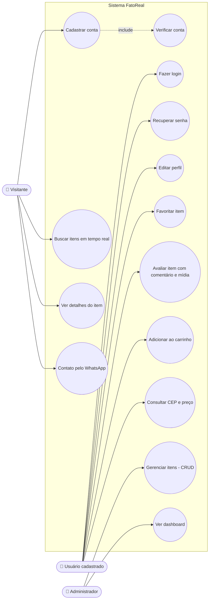

# Diagrama de casos de uso

> O GitHub desenha o diagrama abaixo automaticamente. Para o documento final, refaça no [draw.io](https://app.diagrams.net) ou no Lucidchart com o desenho oficial de UML (bonecos e elipses).

## Descrição dos casos de uso

| Código | Caso de uso | Ator | Descrição resumida |
|---|---|---|---|
| UC01 | Cadastrar conta | Visitante | Informa nome, e-mail e senha; o sistema cria a conta no Supabase. |
| UC02 | Verificar conta | Visitante | Clica no link enviado por e-mail para ativar a conta. |
| UC03 | Fazer login | Usuário | Entra com e-mail e senha. |
| UC04 | Recuperar senha | Usuário | Recebe um e-mail com link para criar nova senha. |
| UC05 | Buscar itens | Visitante/Usuário | A lista é filtrada a cada letra digitada. |
| UC06 | Ver detalhes | Visitante/Usuário | Abre a página do item com fotos e avaliações. |
| UC07 | Editar perfil | Usuário | Altera nome, foto (URL), telefone e endereço. |
| UC08 | Favoritar | Usuário | Adiciona ou remove item da lista de favoritos. |
| UC09 | Avaliar | Usuário | Dá nota de 1 a 5, comentário e imagem (URL). |
| UC10 | Carrinho | Usuário | Adiciona item (com pop-up de confirmação), altera quantidade e remove. |
| UC11 | CEP e preço | Usuário | Digita o CEP; o endereço é preenchido e o preço calculado. |
| UC12 | WhatsApp | Visitante/Usuário | Preenche formulário e é levado ao WhatsApp com a mensagem pronta. |
| UC13 | Gerenciar itens | Administrador | Cadastra, edita, lista e exclui itens. |
| UC14 | Dashboard | Administrador | Vê totais de usuários, itens, avaliações e pedidos. |

### Exemplo de detalhamento (fazer para os principais)

**UC03: Fazer login**
- **Ator:** Usuário cadastrado
- **Pré-condição:** conta verificada
- **Fluxo principal:** 1. Usuário abre a tela de login. 2. Informa e-mail e senha. 3. Sistema valida no Supabase. 4. Redireciona para a página inicial.
- **Fluxo alternativo:** 3a. Dados incorretos → sistema mostra "E-mail ou senha inválidos".
- **Pós-condição:** usuário logado
