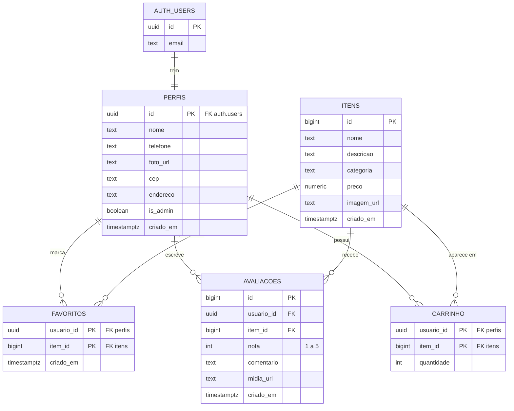

# Modelagem do banco de dados (Supabase / PostgreSQL)

O script para criar tudo está em [`supabase/schema.sql`](../supabase/schema.sql).
A tabela `itens` é genérica: renomeie e adapte as colunas ao tema do projeto.

## Diagrama entidade-relacionamento

## Dicionário de dados

| Tabela | Para que serve |
|---|---|
| `auth.users` | Criada pelo próprio Supabase. Guarda e-mail e senha (criptografada). |
| `perfis` | Dados extras do usuário. É criada automaticamente no cadastro. `is_admin` define quem é administrador. |
| `itens` | O que o sistema exibe (produtos, serviços, etc.). As imagens ficam guardadas como URL. |
| `favoritos` | Liga usuário ↔ item (lista de favoritos). |
| `avaliacoes` | Nota, comentário e mídia (URL de imagem/vídeo). Uma avaliação por usuário e item. |
| `carrinho` | Itens que o usuário adicionou e a quantidade de cada um. |

## Segurança (RLS)
- Qualquer pessoa pode **ver** itens e avaliações.
- Cada usuário só **altera** o próprio perfil, favoritos, avaliações e carrinho.
- Só administradores (`is_admin = true`) podem **criar, editar e excluir** itens.
